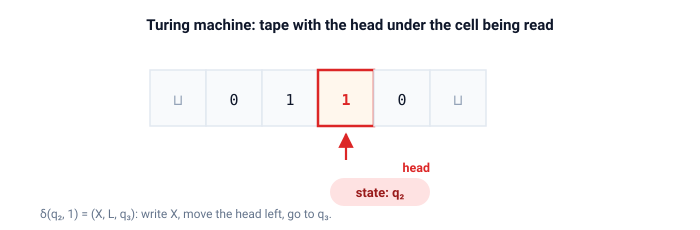

# turing

Turing machines.

A concrete model: a tape held as two stacks, a transition table, accepting and rejecting states, and a trace of every configuration the machine visits.

## Quick start

```bash
cargo test
cargo run --example zero_n_one_n
cargo run --example binary_increment
cargo run --example palindrome
cargo run --example multitape_demo
cargo run --example nondeterministic_demo
cargo run --example universal_demo
```

## The machine

A transition reads the symbol under the head, writes a new one, moves the head, and switches state:

$$ \delta(q, a) = (q', b, d), \qquad d \in \{L, R, S\} $$

A run records every configuration and stops at an accepting or a rejecting state.

### Outcomes

| Outcome    | Meaning                                                    |
| ---------- | ---------------------------------------------------------- |
| `Accepted` | an accepting state was reached                             |
| `Rejected` | a rejecting state was reached                              |
| `Stuck`    | no transition applies: the machine halts without a verdict |
| `Limit`    | `max_steps` transitions taken before the machine halted    |

`Limit` is an engineering substitute for non-termination, not a theoretical outcome.
Whether a machine halts at all is undecidable, so a finite run simply gives up after `max_steps`.

### The tape



The tape cells live in two stacks (`left`, `right`) with the head between them.
Moving the head is moving a symbol between the stacks, so every operation costs $O(1)$.
Never-visited cells hold the blank symbol, and `content_trimmed` strips the leading and trailing blanks after a run.

## Example machines

| Function                       | Language or function computed                               |
| ------------------------------ | ----------------------------------------------------------- |
| `machines::ends_with_zero()`   | Words over $\{0, 1\}$ that end in `0`                       |
| `machines::zero_n_one_n()`     | The language $0^n 1^n$, by crossing out matching pairs      |
| `machines::binary_increment()` | Increments a binary number, least significant bit first     |
| `machines::palindrome()`       | Words over $\{0, 1\}$ that read the same in both directions |
| `machines::copy_reversed()`    | Two tapes: copies a word onto the second tape in reverse    |
| `machines::contains_01()`      | Nondeterministically guesses an occurrence of `01`          |

The last two rows return a `MultiTapeMachine` and a `NondeterministicMachine`, not a `Machine`.

## Multi-tape machines

A multi-tape machine has $k$ tapes with $k$ heads.
One step reads every head, writes one symbol per tape, moves each head independently, and switches state.
The table is keyed by the state together with the tuple of symbols read from the tapes.

```rust
use turing::{machines, Tape};

let tapes = vec![Tape::with_word(&['0', '1'], ' '), Tape::new(' ')];
let run = machines::copy_reversed().run(tapes, 100);
assert_eq!(run.outcome, turing::Outcome::Accepted);
```

`MultiTapeMachine::next` performs one step and `MultiTapeMachine::run` records the trace.
The copy machine shows why the heads are independent: the first head scans right and then walks back left, while the second head only advances during the walk back.
Every transition must carry exactly $k$ writes and $k$ directions.
The constructor checks this and treats a mismatch as a programming error instead of skipping steps silently.

## Nondeterministic machines

A nondeterministic machine maps each (state, symbol) pair to a list of possible steps.
`NondeterministicMachine::next` returns every resulting configuration.
`NondeterministicMachine::run` searches breadth-first up to `max_steps`.

Breadth-first order is the reason the answer means anything: a depth-first search could follow a non-halting branch forever and never try the accepting one.
Level by level, the first accepting configuration is reached in the fewest steps, and the run reports it as a witness path.
A configuration is expanded at most once, so cyclic branches cannot make the search diverge on their own.

| Outcome      | Meaning                                                             |
| ------------ | ------------------------------------------------------------------- |
| `Accepted`   | some branch reached the accepting state, `path` is the witness      |
| `Rejected`   | the reachable configurations are exhausted without an accepting one |
| `Limit`      | branches were still alive when `max_steps` was reached              |

`NondeterministicRun` carries the outcome, the number of steps, the witness path, and how many distinct configurations the search visited.

## Universal machine

`Encoding` stores a machine as data: states, symbols, the designated states, and one row per transition.
`Encoding::from_machine` builds it from a running machine.
`UniversalMachine::decode` rebuilds a `Machine` from it, and `UniversalMachine::run` decodes and runs in one call.

```rust
use turing::{machines, Encoding, Tape, UniversalMachine};

let encoding = Encoding::from_machine(&machines::binary_increment());
let tape = Tape::with_word(&['1', '1'], ' ');
let run = UniversalMachine::new().run(&encoding, tape, 50);
assert_eq!(run.outcome, turing::Outcome::Accepted);
```

The description is the program and the simulator is fixed.
State names are stored as `String` and symbols as `char`.
The blank symbol is not part of the description: a tape carries its own blank, so one description runs on tapes with different blanks.
`Display` prints the description in a readable form, with one transition per line.

## API

| Item                                            | Purpose                                                                                            |
| ----------------------------------------------- | -------------------------------------------------------------------------------------------------- |
| `Tape`                                          | Infinite tape with a head, modelled as two stacks (`left`, `right`)                                |
| `Direction`                                     | `Left`, `Right`, or `Stay`                                                                         |
| `Transition`                                    | Write symbol, move head, go to next state                                                          |
| `Configuration`                                 | Current state plus a tape snapshot                                                                 |
| `Machine`                                       | Transition table plus start, accept, and reject states                                             |
| `Machine::run(tape, max_steps)`                 | Run with a step limit: a non-halting machine ends with `Outcome::Limit` instead of running forever |
| `Machine::next(config)`                         | Compute the next configuration, or `None` if stuck                                                 |
| `Machine::transitions()`                        | Read the transition table, used to encode a machine as data                                        |
| `Machine::start()`, `accept()`, `reject()`      | Read the designated states                                                                         |
| `Run`, `Outcome`                                | The full trace and its verdict: see the outcomes table above                                       |
| `Tape::content()`                               | The full tape content as a `Vec`                                                                   |
| `Tape::content_trimmed()`                       | Tape content with leading and trailing blanks removed                                              |
| `Tape::head_index()`                            | Index of the head inside `Tape::content()`, for drawing a marked tape                              |
| `MultiTapeMachine`                              | `k` tapes with independent heads, one deterministic step per tuple of read symbols                 |
| `MultiTransition`                               | One write and one direction per tape, plus the next state                                          |
| `MultiConfiguration`, `MultiRun`                | A `k`-tape snapshot and the full multi-tape trace                                                  |
| `MultiTapeMachine::next(config)`                | One step over all tapes, or `None` if the read tuple has no transition                             |
| `MultiTapeMachine::run(tapes, max_steps)`       | Run over a vector of tapes and record the trace                                                    |
| `NondeterministicMachine`                       | Transition relation mapping a (state, symbol) pair to several possible steps                       |
| `NondeterministicMachine::next(config)`         | Every configuration reachable in one step                                                          |
| `NondeterministicMachine::run(tape, max_steps)` | Bounded breadth-first search for an accepting branch                                               |
| `NondeterministicOutcome`                       | `Accepted`, `Rejected`, or `Limit`                                                                 |
| `NondeterministicRun`                           | Outcome, steps, witness path, and the number of configurations visited                             |
| `Encoding`                                      | A machine as data: states, symbols, designated states, and transitions                             |
| `EncodedTransition`                             | One row of an encoded table: state, read, write, direction, next state                             |
| `Encoding::from_machine(&m)`                    | Encode any machine with `char` symbols and displayable states                                      |
| `UniversalMachine`                              | Simulator that decodes an `Encoding` and runs the resulting machine                                |
| `UniversalMachine::decode(&e)`                  | Rebuild a `Machine<char, String>` from a description                                               |
| `UniversalMachine::run(&e, tape, max_steps)`    | Decode and run in one call                                                                         |

## Demos

| Demo                    | Shows                                                                       |
| ----------------------- | --------------------------------------------------------------------------- |
| `zero_n_one_n`          | The crossing-out algorithm for $0^n 1^n$, with a full trace on `0011`       |
| `binary_increment`      | Step-by-step binary increment on several inputs, including overflow         |
| `palindrome`            | Palindrome checking with comparison traces: one accepted word, one rejected |
| `multitape_demo`        | Two-tape reverse copy, with both heads marked at every step                 |
| `nondeterministic_demo` | Breadth-first search, a witness path, and a word with no surviving branch   |
| `universal_demo`        | A printed machine description, then decoded runs and a step-by-step trace   |

## Tests

Unit tests live next to the code in `src/`.
They cover:

- every example machine against accept/reject word lists
- the $0^n 1^n$ run, configuration by configuration
- binary increment digit by digit on eight inputs
- a machine that moves right forever, which ends with `Limit`
- the two-tape reverse copy on accepted words, a rejected symbol, a multi-step head trace, and the step limit
- the nondeterministic search on accepted and rejected words, a witness path, a branch killed by a rejecting state, and the step limit
- encoding and decoding every example machine, plus a hand-written description that runs for several steps

Doc-tests run one scenario per public item.
