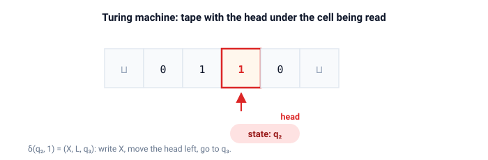

# turing

Машины Тьюринга.

Конкретная модель: лента, хранимая как два стека, таблица переходов, принимающие и отвергающие состояния и след каждой конфигурации, которую посещает машина.

## Быстрый старт

```bash
cargo test
cargo run --example zero_n_one_n
cargo run --example binary_increment
cargo run --example palindrome
cargo run --example multitape_demo
cargo run --example nondeterministic_demo
cargo run --example universal_demo
```

## Машина

Переход читает символ под головкой, записывает новый, перемещает головку и меняет состояние:

$$ \delta(q, a) = (q', b, d), \qquad d \in \{L, R, S\} $$

Запуск записывает каждую конфигурацию и останавливается в принимающем или отвергающем состоянии.

### Исходы запуска

| Итог       | Что означает                                                     |
| ---------- | ---------------------------------------------------------------- |
| `Accepted` | достигнуто принимающее состояние                                 |
| `Rejected` | достигнуто отвергающее состояние                                 |
| `Stuck`    | ни один переход не применим: машина останавливается без вердикта |
| `Limit`    | выполнено `max_steps` переходов без остановки машины             |

`Limit` — инженерная замена незавершения, а не теоретический исход.
Завершается ли машина вообще — неразрешимый вопрос, поэтому конечный запуск просто сдаётся после `max_steps`.

### Лента



Ячейки ленты живут в двух стеках (`left`, `right`), а головка находится между ними.
Перемещение головки — это перенос символа между стеками, так что каждая операция стоит $O(1)$.
Непосещённые ячейки хранят пустой символ, а `content_trimmed` срезает ведущие и замыкающие пустые ячейки после запуска.

## Примеры машин

| Функция                        | Язык или вычисляемая функция                                   |
| ------------------------------ | -------------------------------------------------------------- |
| `machines::ends_with_zero()`   | Слова над $\{0, 1\}$, оканчивающиеся на `0`                    |
| `machines::zero_n_one_n()`     | Язык $0^n 1^n$ вычёркиванием совпадающих пар                   |
| `machines::binary_increment()` | Увеличивает двоичное число, младший бит первым                 |
| `machines::palindrome()`       | Слова над $\{0, 1\}$, которые читаются одинаково в обе стороны |
| `machines::copy_reversed()`    | Две ленты: копирует слово на вторую ленту в обратном порядке   |
| `machines::contains_01()`      | Недетерминированно угадывает вхождение `01`                    |

Последние две строки возвращают `MultiTapeMachine` и `NondeterministicMachine`, а не `Machine`.

## Многоленточные машины

У многоленточной машины $k$ лент и $k$ головок.
За один шаг она читает все головки, записывает по одному символу на каждую ленту, независимо двигает каждую головку и меняет состояние.
Ключ таблицы переходов: состояние вместе с кортежем прочитанных символов.

```rust
use turing::{machines, Tape};

let tapes = vec![Tape::with_word(&['0', '1'], ' '), Tape::new(' ')];
let run = machines::copy_reversed().run(tapes, 100);
assert_eq!(run.outcome, turing::Outcome::Accepted);
```

`MultiTapeMachine::next` выполняет один шаг, а `MultiTapeMachine::run` записывает след.
Машина копирования показывает, зачем головкам независимость: первая головка идёт вправо, затем возвращается влево, а вторая головка двигается только на обратном проходе.
В каждом переходе должно быть ровно $k$ записей и $k$ направлений.
Конструктор проверяет это и считает несовпадение ошибкой программы, а не пропускает шаги молча.

## Недетерминированные машины

Недетерминированная машина сопоставляет каждой паре (состояние, символ) список возможных шагов.
`NondeterministicMachine::next` возвращает все получившиеся конфигурации.
`NondeterministicMachine::run` ищет в ширину с ограничением `max_steps`.

Порядок в ширину важен по существу: поиск в глубину мог бы уйти в незавершающуюся ветвь и никогда не попробовать принимающую.
По уровням первая найденная принимающая конфигурация достигается за минимальное число шагов, и запуск возвращает её как путь-свидетель.
Каждая конфигурация раскрывается не более одного раза, поэтому циклы сами по себе не уводят поиск в бесконечность.

| Итог        | Что означает                                                          |
| ----------- | --------------------------------------------------------------------- |
| `Accepted`  | какая-то ветвь дошла до принимающего состояния, `path` это свидетель  |
| `Rejected`  | достижимые конфигурации исчерпаны, принимающей среди них нет          |
| `Limit`     | на пределе `max_steps` ещё оставались живые ветви                     |

`NondeterministicRun` хранит итог, число шагов, путь-свидетель и число посещённых различных конфигураций.

## Универсальная машина

`Encoding` хранит машину как данные: состояния, символы, выделенные состояния и по строке на каждый переход.
`Encoding::from_machine` строит кодировку по работающей машине.
`UniversalMachine::decode` восстанавливает по ней `Machine`, а `UniversalMachine::run` декодирует и запускает за один вызов.

```rust
use turing::{machines, Encoding, Tape, UniversalMachine};

let encoding = Encoding::from_machine(&machines::binary_increment());
let tape = Tape::with_word(&['1', '1'], ' ');
let run = UniversalMachine::new().run(&encoding, tape, 50);
assert_eq!(run.outcome, turing::Outcome::Accepted);
```

Описание это программа, а симулятор фиксирован.
Имена состояний хранятся как `String`, символы как `char`.
Пустой символ не входит в описание: пустой символ принадлежит ленте, поэтому одно описание работает с лентами, у которых разные пустые символы.
`Display` печатает описание в читаемом виде, по одному переходу на строку.

## API

| Элемент                                         | Назначение                                                                                                       |
| ----------------------------------------------- | ---------------------------------------------------------------------------------------------------------------- |
| `Tape`                                          | Бесконечная лента с головкой, смоделированная как два стека (`left`, `right`)                                    |
| `Direction`                                     | `Left`, `Right` или `Stay`                                                                                       |
| `Transition`                                    | Записать символ, переместить головку, перейти в следующее состояние                                              |
| `Configuration`                                 | Текущее состояние плюс снимок ленты                                                                              |
| `Machine`                                       | Таблица переходов плюс начальное, принимающее и отвергающее состояния                                            |
| `Machine::run(tape, max_steps)`                 | Запуск с ограничением шагов: неостанавливающаяся машина завершается с `Outcome::Limit` вместо бесконечной работы |
| `Machine::next(config)`                         | Вычислить следующую конфигурацию или `None`, если машина застряла                                                |
| `Machine::transitions()`                        | Прочитать таблицу переходов, нужна для кодирования машины как данных                                             |
| `Machine::start()`, `accept()`, `reject()`      | Прочитать выделенные состояния                                                                                   |
| `Run`, `Outcome`                                | Полный след и его вердикт: см. таблицу исходов выше                                                              |
| `Tape::content()`                               | Полное содержимое ленты как `Vec`                                                                                |
| `Tape::content_trimmed()`                       | Содержимое ленты без ведущих и замыкающих пустых символов                                                        |
| `Tape::head_index()`                            | Индекс головки внутри `Tape::content()`, для отрисовки ленты с отметкой                                          |
| `MultiTapeMachine`                              | $k$ лент с независимыми головками, один детерминированный шаг на кортеж прочитанных символов                     |
| `MultiTransition`                               | По одной записи и одному направлению на ленту плюс следующее состояние                                           |
| `MultiConfiguration`, `MultiRun`                | Снимок $k$ лент и полный след многоленточного запуска                                                            |
| `MultiTapeMachine::next(config)`                | Один шаг по всем лентам или `None`, если для кортежа нет перехода                                                |
| `MultiTapeMachine::run(tapes, max_steps)`       | Запуск на векторе лент с записью следа                                                                           |
| `NondeterministicMachine`                       | Отношение переходов, сопоставляющее паре (состояние, символ) несколько возможных шагов                           |
| `NondeterministicMachine::next(config)`         | Все конфигурации, достижимые за один шаг                                                                         |
| `NondeterministicMachine::run(tape, max_steps)` | Поиск в ширину с ограничением глубины до принимающей ветви                                                       |
| `NondeterministicOutcome`                       | `Accepted`, `Rejected` или `Limit`                                                                               |
| `NondeterministicRun`                           | Итог, число шагов, путь-свидетель и число посещённых конфигураций                                                |
| `Encoding`                                      | Машина как данные: состояния, символы, выделенные состояния и переходы                                           |
| `EncodedTransition`                             | Одна строка таблицы: состояние, чтение, запись, направление, следующее состояние                                 |
| `Encoding::from_machine(&m)`                    | Кодирует любую машину с символами `char` и состояниями, которые можно напечатать                                 |
| `UniversalMachine`                              | Симулятор, который декодирует `Encoding` и запускает полученную машину                                           |
| `UniversalMachine::decode(&e)`                  | Восстанавливает `Machine<char, String>` по описанию                                                              |
| `UniversalMachine::run(&e, tape, max_steps)`    | Декодирует и запускает за один вызов                                                                             |

## Демо

| Демо                    | Что показывает                                                                        |
| ----------------------- | ------------------------------------------------------------------------------------- |
| `zero_n_one_n`          | Алгоритм вычёркивания для $0^n 1^n$ с полным следом на `0011`                         |
| `binary_increment`      | Пошаговое увеличение двоичного числа на нескольких входах, включая переполнение       |
| `palindrome`            | Проверка палиндрома со следами сравнения: одно принято, одно отвергнуто               |
| `multitape_demo`        | Двухленточное копирование в обратном порядке с отметками обеих головок на каждом шаге |
| `nondeterministic_demo` | Поиск в ширину, путь-свидетель и слово, у которого не выжила ни одна ветвь            |
| `universal_demo`        | Напечатанное описание машины, затем декодированные запуски и пошаговый след           |

## Тесты

Модульные тесты лежат рядом с кодом в `src/`.
Они проверяют:

- каждую машину-пример на списках принимаемых и отвергаемых слов
- запуск для $0^n 1^n$, конфигурация за конфигурацией
- двоичное увеличение поразрядно на восьми входах
- машину, вечно движущуюся вправо, — она завершается с `Limit`
- двухленточное копирование в обратном порядке: принятые слова, отвергнутый символ, след с независимым движением головок и предел шагов
- недетерминированный поиск: принятые и отвергнутые слова, путь-свидетель, ветвь, убитую отвергающим состоянием, и предел шагов
- кодирование и декодирование каждой машины-примера плюс рукописное описание, которое выполняется несколько шагов

Doc-тесты прогоняют по одному сценарию на каждый публичный элемент.
